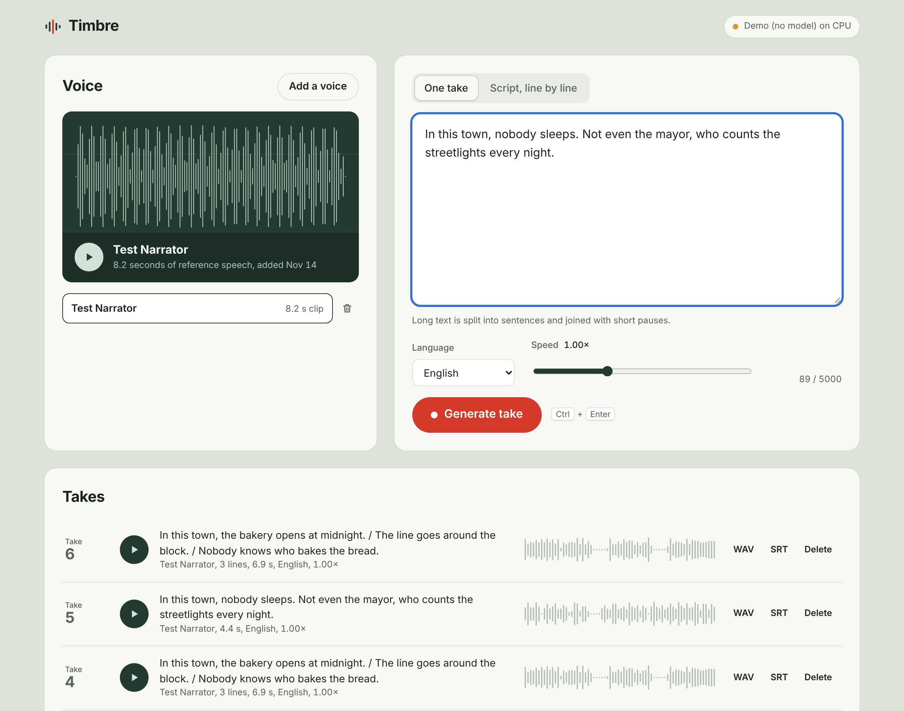

# Timbre

**A local voice cloning studio.** Give it 10–30 seconds of someone speaking, type a script, and get back natural speech in that voice, with subtitles. Everything runs on your own machine.



## Features

- **Zero-shot cloning** with [XTTS-v2](https://huggingface.co/coqui/XTTS-v2): no training, just a short reference clip
- **Upload or record** reference voices in the browser, with automatic cleanup (silence trimming, loudness normalization, resampling)
- **Voice library**: save voices once and reuse them
- **One take or a whole script**: batch mode turns each line into its own clip, plus one merged file
- **Subtitles**: every take comes with a timed `.srt` file
- **17 languages**, adjustable speed
- **Swappable engines**: a clean `Engine` interface, plus a demo engine that runs with no model or GPU
- **Web studio, CLI and JSON API**

## Quick start

Requires Python 3.10+ and [ffmpeg](https://ffmpeg.org/download.html) (for mp3/m4a/webm input).

```bash
git clone https://github.com/earldavemurillo123-create/timbre.git
cd timbre
python -m venv .venv
source .venv/bin/activate        # Windows: .venv\Scripts\activate

# 1. Install PyTorch for your hardware: https://pytorch.org/get-started/locally/
# 2. Install everything else
pip install -r requirements.txt

python cli.py serve
```

Open **http://127.0.0.1:7860**. The first launch downloads the XTTS-v2 weights (~1.8 GB) and asks you to accept the model license. To accept it in advance, set `COQUI_TOS_AGREED=1`.

### Windows shortcut

Double-click these, in order:

1. `run-demo.bat` sets up a virtual environment, installs the core packages and opens the studio with the demo engine.
2. `install-voice-model.bat` installs PyTorch (CPU) and the XTTS model package.
3. `run-timbre.bat` starts the studio with the real voice model.

### Try it without a model

```bash
pip install fastapi "uvicorn[standard]" python-multipart numpy scipy
python cli.py --engine demo serve
```

The demo engine produces a placeholder hum that follows the voice's pitch. It's useful for working on the interface or for machines without a GPU.

## Command line

```bash
python cli.py voices add "Narrator" my-voice.wav --consent
python cli.py voices list
python cli.py speak narrator-1a2b3c "Hello from Timbre." -o hello.wav
python cli.py batch narrator-1a2b3c examples/script.txt --language en --speed 1.1
```

Generated takes are saved in `data/takes/<take-id>/` as `take.wav`, `take.srt` and (for scripts) `line-1.wav`, `line-2.wav`, …

## Tips for a good clone

- 10–30 seconds of **one speaker**, no background music, little room echo
- Natural sentences in a normal speaking voice. Expressive references give expressive output.
- The reference language doesn't have to match the output language, but matching it sounds best.

## How it works

```
reference clip ──► cleanup ──► speaker embedding ─┐
                                                  ├──► XTTS-v2 ──► audio per sentence ──► join + pauses ──► take.wav + take.srt
script ──► sentence splitting ────────────────────┘
```

| Path | Purpose |
|---|---|
| `timbre/audio.py` | Loading (ffmpeg fallback), trimming, normalizing, WAV writing with a "synthetic" tag |
| `timbre/text.py` | Sentence splitting, chunking, script parsing, SRT building |
| `timbre/engines/` | `Engine` interface, XTTS-v2 and demo engines |
| `timbre/voices.py` | Saved voice library |
| `timbre/studio.py` | Generation service shared by the server and CLI |
| `timbre/server.py` | FastAPI app: JSON API + static web UI |
| `web/` | The studio interface (plain HTML/CSS/JS, no build step) |

### Adding another model

Subclass `Engine` in `timbre/engines/`, implement `load()` and `synthesize()`, then register it in `ENGINES` in `timbre/engines/__init__.py`. Start it with `--engine yourname`.

### API

| Method | Route | Description |
|---|---|---|
| `GET` | `/api/status` | Engine name, device, languages |
| `GET` / `POST` | `/api/voices` | List voices / add one (multipart: `name`, `consent`, `file`) |
| `PATCH` / `DELETE` | `/api/voices/{id}` | Rename / delete |
| `POST` | `/api/speak` | `{voice_id, text, language, speed}` → take |
| `POST` | `/api/batch` | `{voice_id, script, language, speed}` → take |
| `GET` | `/api/takes` | Recent takes |
| `GET` | `/api/takes/{id}/{file}` | Download audio or subtitles (`?download=true`) |

Interactive docs are at `/docs` while the server is running.

## Configuration

| Variable | Default | |
|---|---|---|
| `TIMBRE_ENGINE` | `xtts` | `xtts` or `demo` |
| `TIMBRE_DEVICE` | `auto` | `auto`, `cuda` or `cpu` |
| `TIMBRE_DATA_DIR` | `./data` | Where voices and takes are stored |

## Running tests

```bash
pytest
```

The tests use the demo engine, so they run in about a second without a GPU.

## Responsible use

Voice cloning can be misused to impersonate people. Timbre is built for your own voice, voices you have explicit permission to use, and fictional characters you voice yourself.

- Saving a voice requires confirming you have the speaker's permission.
- Every generated WAV carries an embedded comment marking it as synthetic speech.
- Don't use Timbre to deceive, defraud or harass anyone, or to create content that a person hasn't agreed to.

## License

Timbre's code is MIT licensed. The XTTS-v2 model weights are under the [Coqui Public Model License](https://coqui.ai/cpml), which **does not allow commercial use**. Check the license of any model you plug in.

## Credits

- [XTTS-v2](https://huggingface.co/coqui/XTTS-v2) by Coqui, maintained in the [coqui-tts](https://github.com/idiap/coqui-ai-TTS) fork
- Interface typeface: [Bricolage Grotesque](https://fonts.google.com/specimen/Bricolage+Grotesque)
